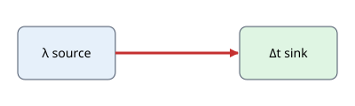
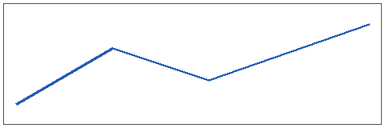

# Features

## Inline math, display math, boxes

Inline math becomes Unicode text: $t_a \le t_{mr}$, $\varphi = p_v / p_{sat}(t)$, $x^2 + \Delta t$ and $\frac{a+b}{2}$.

$$k = \frac{1}{R_{tot}}, \qquad R_{tot} = \frac{1}{\alpha_I} + \sum_i \frac{\delta_i}{\lambda_i}$$

> **Operative temperature** $t_o$: roughly the average of air temperature $t_a$ and mean radiant temperature $t_{mr}$.

> **Second box**: one box per blockquote.

## Figures



*Figure: an SVG with a marker and Greek text*


*Figure: an SVG without markers*



*Figure: a PNG chart*

## Code and output

```python
print("fenced code stays")
```

Result of a cell:

    PMV = 0.278
    PPD = 6.4 %
